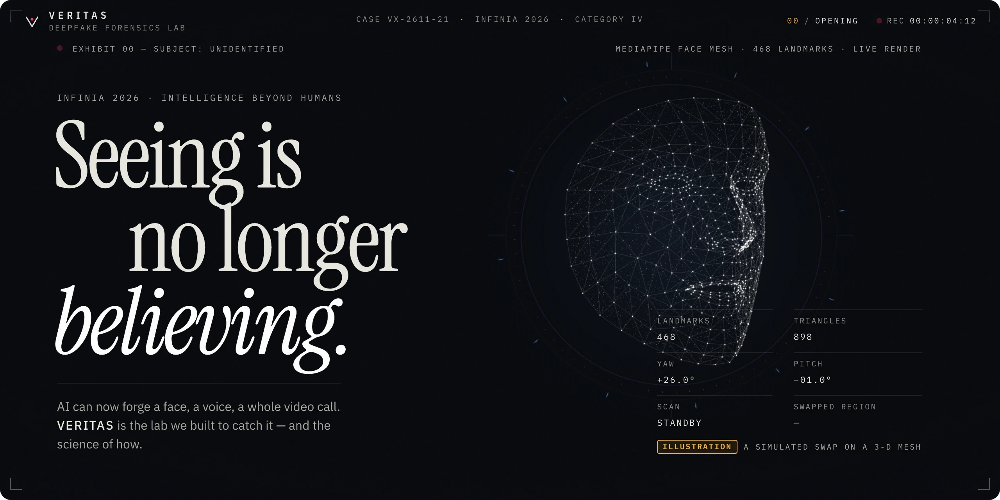
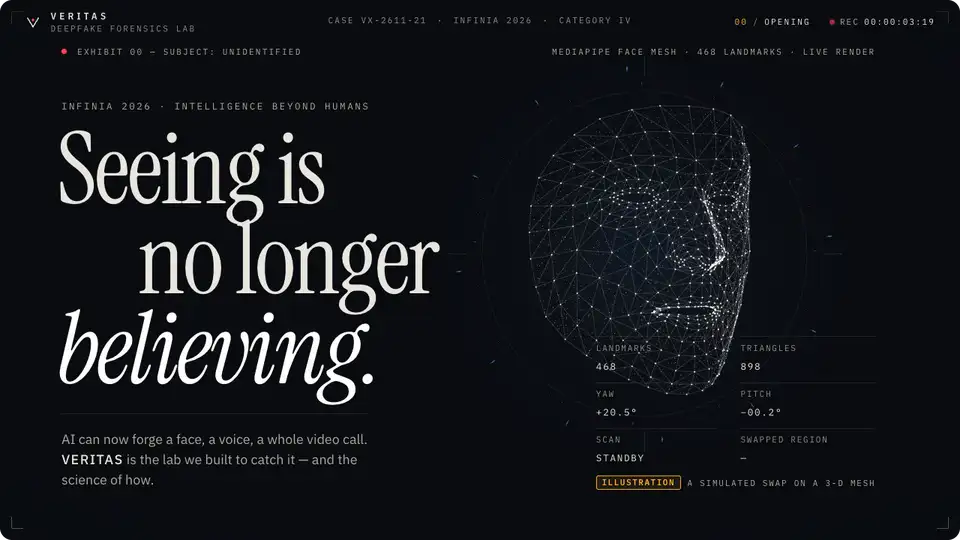
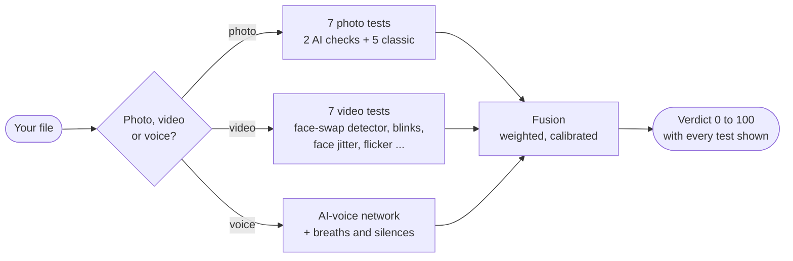
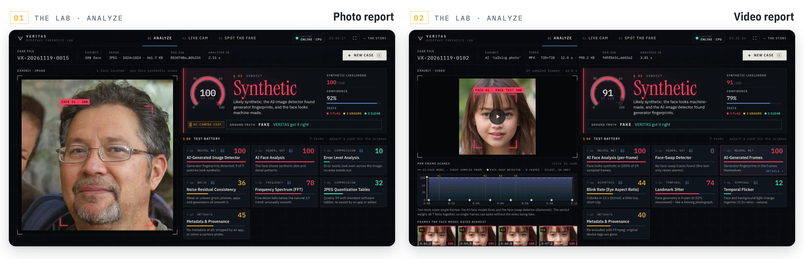
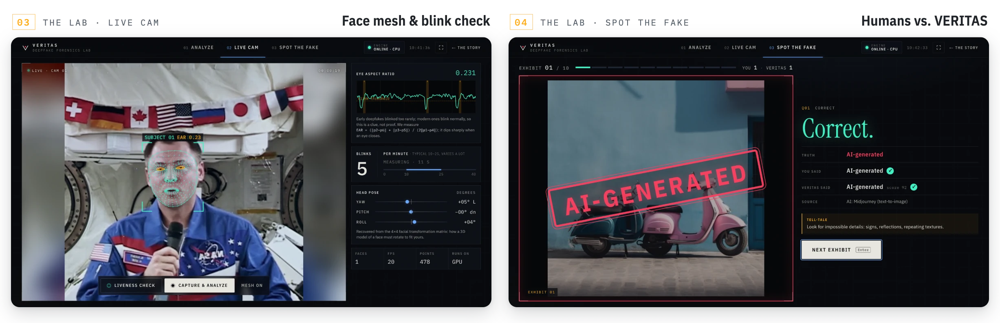
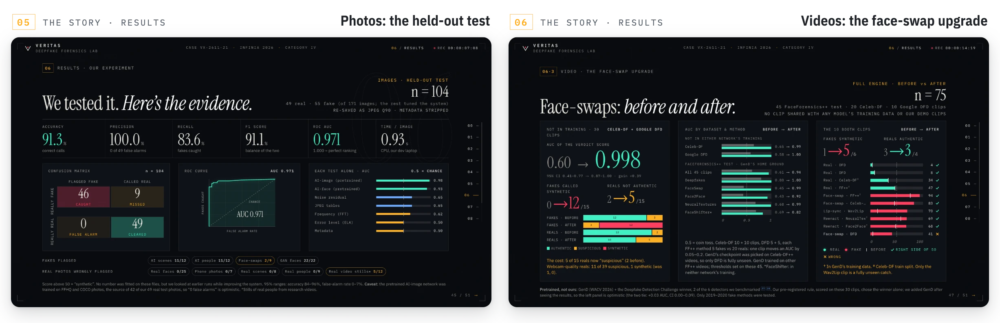
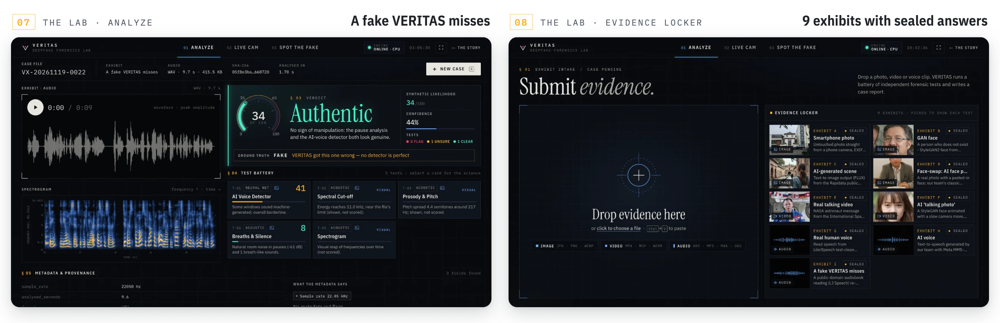

<p align="center">
  <a href="https://veritas-infinia-2026.tocodex42.chatgpt.site/"></a>
</p>

<h3 align="center">A deepfake detective you can run on any Windows laptop.<br>Give it a photo, a video or a voice clip, and it shows you, test by test, whether AI made it.</h3>

<p align="center">
  <a href="https://veritas-infinia-2026.tocodex42.chatgpt.site/"></a>
  <a href="https://veritas-infinia-2026.tocodex42.chatgpt.site/lab.html"></a>
  <a href="https://github.com/Ahamedinmotion/veritas/releases/latest/download/VERITAS-Windows.zip"></a>
</p>

<p align="center">
  <a href="https://github.com/Ahamedinmotion/veritas/releases/latest/download/VERITAS-Guide.pdf"><b>Read the step-by-step guide (PDF)</b></a>
  &nbsp;·&nbsp; Built by Khais Mohammed and Prithvi, CNPS, for INFINIA 2026
  <br><sub>Website: <a href="https://veritas-infinia-2026.tocodex42.chatgpt.site/">veritas-infinia-2026.tocodex42.chatgpt.site</a> &nbsp;·&nbsp; mirror: <a href="https://ahamedinmotion.github.io/veritas/">ahamedinmotion.github.io/veritas</a></sub>
</p>

---

## Not technical? Do just this

You need a **Windows 10 or 11 laptop** with about **8 GB of free space**, and **internet once** for the setup.
After that, VERITAS works with no internet at all.

1. **Download it.** Click the **Download for Windows** button above. You get `VERITAS-Windows.zip`
   (look in your **Downloads** folder). Right-click it, choose **Extract All…**, then click **Extract**.
2. **Run the setup once.** Open the new **VERITAS** folder and double-click **`1 - SETUP (run once).bat`**.
   A black window downloads everything VERITAS needs (about 3.5 GB, usually 15–30 minutes).
   Leave it alone until it says **ALL DONE**. It also puts two icons on your Desktop.
3. **Start VERITAS.** Double-click **VERITAS** on the Desktop. The story opens in your browser. A black engine
   window opens too: leave it open (you can minimise it), because closing it stops VERITAS. The first start can take
   a few minutes; after that about 30 seconds. No internet needed.

> [!TIP]
> **Edge says the download "isn't commonly downloaded"?** Click **…** next to it, then **Keep**, then **Keep anyway**.
>
> **Windows says "Windows protected your PC"?** Click **More info**, then **Run anyway**. Windows shows this blue
> box for every new program that is not from a big company. VERITAS is safe to run.

> [!NOTE]
> The second Desktop icon, **VERITAS demo clips**, is a folder of photos, videos and voices for the booth: drag any
> of them into the lab. Setup downloads the research clips in it straight from the public research
> collections they come from. They are never stored in this repository.
>
> If the Desktop icon is missing, open the **VERITAS** folder and double-click **`2 - START VERITAS.bat`**.
> Stuck? The [guide (PDF)](https://github.com/Ahamedinmotion/veritas/releases/latest/download/VERITAS-Guide.pdf) explains every step.

---

## What VERITAS does

<p align="center">
  
  <br><sub>The opening of the story, the scroll-through presentation that replaces slides at our stand.</sub>
</p>

AI can now fake a face, a voice or a whole video call. VERITAS is our answer: a **forensics lab** that takes one
file, runs a set of independent tests on it, and writes a **case report** that shows every piece of evidence,
not just a yes or no.

| You give it | What it checks |
|---|---|
| **A photo** | An AI-image network, run on the whole picture and again on every face, plus five classic forensic tests: error levels, camera grain, the frequency spectrum, the JPEG compression tables and the metadata. |
| **A video** | A **face-swap detector** (two published networks), an AI-face check on every sampled frame, AI-made frames, how often the person blinks, unnatural shaking of the face, flicker, and the metadata. |
| **A voice clip** | An AI-voice network and the breaths and silences between words. A spectrogram, a pitch track and the frequency cut-off are shown as evidence but not scored. |

Every test gives a score from 0 to 100. VERITAS combines them into one verdict: below **35 authentic**,
**35–65 suspicious**, above **65 synthetic**.



**How the scores are combined (fusion).** Each score is turned into odds, the odds are averaged with weights (the
AI networks carry about 70% of the weight), and a calibration step, fitted on separate tuning files and never on the
test files, turns the result back into a 0–100 score. A test that cannot run (no face, no speech) drops out. The face-swap detector is **one-sided**:
it can raise an alarm but can never vouch for a video. Details: [`docs/ENGINE.md`](docs/ENGINE.md).

**Three ways to use it**

- **Analyze:** drop in a file, or open one of the 9 exhibits in the **Evidence locker** (each has a sealed answer
  that the report reveals).
- **Live Cam:** a 478-point face mesh, a blink counter and head pose, all worked out inside your browser, plus a
  liveness check.
- **Spot the Fake:** ten pictures, real or AI. Play against VERITAS and see who wins.

**Online or offline?** On the booth laptop (the Windows version) VERITAS runs completely offline: nothing you
analyse leaves the laptop. The [online lab](https://veritas-infinia-2026.tocodex42.chatgpt.site/lab.html) runs in **showcase mode** and uploads nothing: the 9
Evidence-locker exhibits open the real reports our engine saved, and Live Cam and Spot the Fake work right in your
browser. It does not analyse new files. To check your own photos, videos and voice clips, run VERITAS on a laptop:
the Windows download above, or from source on macOS or Linux (see *For developers* below).

---

## Our results, honestly

We tested VERITAS on files kept apart from tuning, and we wrote down where it fails, so please read "The catch" too.
Full numbers:
[`web/data/results.json`](web/data/results.json) (chapter 06 of the story draws its charts from this file) and
[`docs/MODEL_SELECTION.md`](docs/MODEL_SELECTION.md).

| | What we measured | The catch |
|---|---|---|
| **Photos**<br><sub>104 held-out images (49 real, 55 fake); no setting was tuned on them</sub> | **91.3%** correct, AUC **0.971**.<br>**0 of 49** real photos flagged.<br>**46 of 55** fakes caught: all 22 GAN faces, 22 of 24 diffusion images. | Our own face-swap photos: only **2 of 9** caught. The image network was trained on the same photo collections as 42 of our 49 real photos, so "0 false alarms" is optimistic. Stills of real people from compressed videos: **5 of 12** flagged. With so few images, the 95% range for accuracy is 84–96%. |
| **Videos**<br><sub>30 clips from Celeb-DF and Google DFD (15 real, 15 fake), datasets neither face-swap network was trained on</sub> | AUC **0.60 → 0.998** after adding the face-swap detector.<br>Fakes called synthetic: **0 → 12 of 15** (the other 3: suspicious). | **0.998 is optimistic:** we ranked the 6 candidate detectors on these same clips and chose the pair after seeing them. With so few clips the plausible range is about 0.87 to 1.00, and only Google DFD (10 clips) is fully unseen: GenD's authors used Celeb-DF videos to pick their checkpoint. Real clips called suspicious went from 2 to **5 of 15**. Grainy, webcam-quality real video raises false alarms (11 of 39 suspicious, 1 synthetic). Only 2019–2020 fake methods were tested. |
| **Voices**<br><sub>136 held-out clips: same datasets as our tuning, new speakers</sub> | **75.7%** correct, AUC **0.81**. | This is the optimistic number. On 10 outside clips only **2 of 6** fakes were caught. When a whole dataset was left out of tuning, **75%** of real voices recorded on everyday microphones were flagged. |
| **Spot the Fake**<br><sub>the 30 pictures in the game</sub> | VERITAS gets **27 of 30** right. | In a 2022 study, people sorting real faces from AI faces were right only **48.2%** of the time. |

**Speed.** A photo takes about a second on our development laptop. A video takes about 5–6 seconds on our development Mac but **33–43 seconds
on a slow 4-core laptop**. VERITAS uses about 3.7 GB of memory while it analyses a video.

> [!IMPORTANT]
> **What is ours and what is borrowed.** Every AI network in VERITAS is an open, pretrained model that we chose by
> experiment (12 image candidates, 7 voice candidates, 6 face-swap detectors). We did **not** train them. We built
> the classic forensic tests, the voice probe on top of the voice network, the calibration, the fusion rule, the
> face-swap benchmark, the whole evaluation, the lab and the story.

---

## Screenshots

<picture>
  <source media="(prefers-color-scheme: dark)" srcset="docs/readme/gallery-lab-dark.webp">
  <source media="(prefers-color-scheme: light)" srcset="docs/readme/gallery-lab-light.webp">
  
</picture>
<sub><b>01</b> A face made by a GAN (the person does not exist): the AI networks flag it, verdict Synthetic 100. &nbsp;
<b>02</b> An AI "talking photo" video: a score for every sampled frame, keyframes and seven tests.</sub><br><br>

<picture>
  <source media="(prefers-color-scheme: dark)" srcset="docs/readme/gallery-live-dark.webp">
  <source media="(prefers-color-scheme: light)" srcset="docs/readme/gallery-live-light.webp">
  
</picture>
<sub><b>03</b> Live Cam: face mesh, blinks and head pose, worked out in the browser (shown here on a public-domain NASA
video). &nbsp; <b>04</b> Spot the Fake: humans against VERITAS.</sub><br><br>

<picture>
  <source media="(prefers-color-scheme: dark)" srcset="docs/readme/gallery-results-dark.webp">
  <source media="(prefers-color-scheme: light)" srcset="docs/readme/gallery-results-light.webp">
  
</picture>
<sub><b>05</b> The story's results chapter: the photo test. &nbsp; <b>06</b> Videos before and after the face-swap
detector, with the caveats printed on the slide.</sub><br><br>

<picture>
  <source media="(prefers-color-scheme: dark)" srcset="docs/readme/gallery-honest-dark.webp">
  <source media="(prefers-color-scheme: light)" srcset="docs/readme/gallery-honest-light.webp">
  
</picture>
<sub><b>07</b> A fake voice VERITAS misses: we show our failures too. &nbsp; <b>08</b> The Evidence locker: nine
exhibits with sealed answers.</sub>

---

## The team

- **Khais Mohammed** and **Prithvi**
- CNPS
- **INFINIA 2026**, South Zone Sahodaya inter-school science exhibition, Thiruvananthapuram.
  Category IV (Classes XI–XII). Theme *Science for Tomorrow: Imagine – Innovate – Transform*, sub-theme
  *Intelligence Beyond Humans*.

**Ethics.** We never faked a celebrity, a politician or anyone we know. Every test fake comes from a public research
dataset or was made by us from research material (for example GAN faces of people who do not exist), and exists only
to test the detector.

## Credits

VERITAS stands on the work of many researchers. Every source and licence is listed in
[`docs/DATA_SOURCES.md`](docs/DATA_SOURCES.md) and [`docs/SOURCES_STORY.md`](docs/SOURCES_STORY.md).

- **AI models (pretrained, not ours):** CommunityForensics ViT (Park & Owens, CVPR 2025) for AI images;
  wav2vec2 fine-tuned on In-the-Wild deepfake speech (abhishtagatya) for voices; for face-swaps,
  **GenD** (Yermakov et al., WACV 2026, built on OpenAI's CLIP) and the **Deepfake Detection Challenge winner**
  (EfficientNet-B7, Seferbekov 2020). Faces are found with YuNet (OpenCV Zoo), MediaPipe Face Landmarker, SCRFD
  (InsightFace) and MTCNN (facenet-pytorch).
- **Test data:** FFHQ, MS-COCO, Wikimedia Commons phone photos, thispersondoesnotexist.com faces, the Rapidata
  text-to-image set, LibriSpeech, LJ Speech, WaveFake, ASVspoof 2019, FLEURS and others; for video,
  FaceForensics++, Celeb-DF v2 and Google's DeepFakeDetection (DFD).
- **Research clips are not redistributed.** FaceForensics++, Celeb-DF, Google DFD and the Wav2Lip clip we made from
  DFD footage are not in this repository, the website, the online lab or the Windows download. The Windows setup
  downloads the booth demo clips directly from the public mirrors they came from.
- **Software:** FastAPI, PyTorch, ONNX Runtime, OpenCV, librosa, three.js, GSAP, Lenis, MediaPipe; fonts IBM Plex
  and Instrument Serif.

<details>
<summary><b>For developers</b> (run from source, architecture, experiments)</summary>

### Run on macOS or Linux

```bash
git clone https://github.com/Ahamedinmotion/veritas.git && cd veritas
uv sync --locked                                         # Python 3.12 environment (once, with internet)
uv run python scripts/download_models.py                 # AI models, about 2.4 GB (once, with internet)
./scripts/start_mac.sh                                   # starts the engine, opens http://localhost:8000/
HF_HUB_OFFLINE=1 .venv/bin/python scripts/selftest.py    # every locker exhibit; must say ALL PASS
# or start the engine by hand:
uv run uvicorn server.app:app --host 127.0.0.1 --port 8000
```

Use Chrome or Edge. `http://127.0.0.1:8000/api/health` should show `"ok": true` and all four models `true`.
On Windows from a clone: `scripts\setup_windows.bat` once, then `scripts\start_windows.bat`
(booth checklist and fallbacks: [`docs/SETUP_WINDOWS.md`](docs/SETUP_WINDOWS.md)).

### How it fits together

- `server/`: the FastAPI engine. `pipeline.py`, `video_pipeline.py` and `audio_pipeline.py` run the tests in
  `server/forensics/` (one module per test), `fusion.py` combines them. It also serves the web pages.
- `web/index.html` is the story, `web/lab.html` the lab (`web/js/story/`, `web/js/lab/`). Fonts and libraries
  are bundled, so the pages load nothing from other websites (the lab only asks whether an online engine is configured and answering).
- The lab looks for an engine in this order: the same server (`/api/health`), then
  `window.VERITAS_CONFIG.onlineApi` from `web/js/config.js`, then showcase mode (saved reports).
- API contract: [`docs/ARCHITECTURE.md`](docs/ARCHITECTURE.md). How every test works and its limits:
  [`docs/ENGINE.md`](docs/ENGINE.md). How the models were chosen: [`docs/MODEL_SELECTION.md`](docs/MODEL_SELECTION.md).
  Booth script and judge questions: [`docs/PITCH.md`](docs/PITCH.md), [`docs/JUDGE_QA.md`](docs/JUDGE_QA.md).

### Re-run the experiments

The test files are not in the repository (`eval_data/` is ignored by git). Rebuild them first:

```bash
uv run --with pyarrow python scripts/build_eval_data.py # downloads the public test sets
uv run python scripts/evaluate.py                       # photos + voices, about 45 min; writes web/data/results.json
uv run python scripts/compare_models.py --kind image    # the model shoot-out (docs/MODEL_SELECTION.md)
uv run python scripts/evaluate_video.py                 # 75-clip face-swap benchmark (needs the research clips)
uv run python scripts/evaluate_faceswap_images.py       # why the face-swap detector is video-only
```

### Keyboard shortcuts

| Story | | Lab | |
|---|---|---|---|
| <kbd>→</kbd> <kbd>Space</kbd> <kbd>PageDown</kbd> | next step (USB clickers work) | <kbd>1</kbd> <kbd>2</kbd> <kbd>3</kbd> | Analyze / Live Cam / Spot the Fake |
| <kbd>←</kbd> <kbd>PageUp</kbd> | previous step | <kbd>N</kbd> | new case |
| <kbd>0</kbd>–<kbd>8</kbd> | jump to a chapter | <kbd>Esc</kbd> | cancel a scan, close a test card |
| <kbd>F</kbd> | fullscreen | <kbd>L</kbd> <kbd>C</kbd> <kbd>M</kbd> | Live Cam: liveness / capture / mesh |
| <kbd>?</kbd> | show all keys | <kbd>←</kbd> real · <kbd>→</kbd> AI | Spot the Fake |

</details>

## Licence

The VERITAS code is released under the [MIT Licence](LICENSE), © 2026 the VERITAS team (Khais Mohammed, Prithvi).
The third-party models, libraries, fonts and media keep their own licences, listed in
[`docs/DATA_SOURCES.md`](docs/DATA_SOURCES.md). Some of them are for non-commercial research only (for example the
SCRFD face detector and the FFHQ photos), so check those terms before reusing them.
